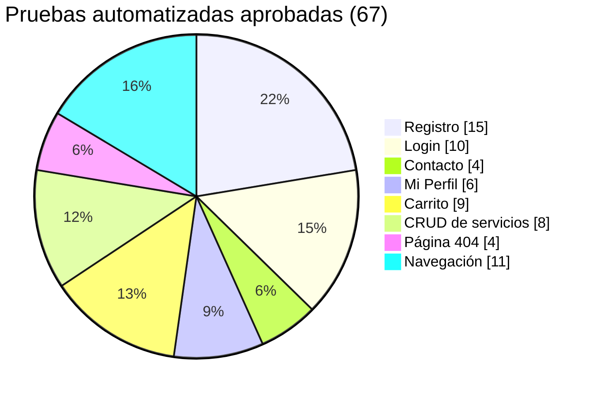
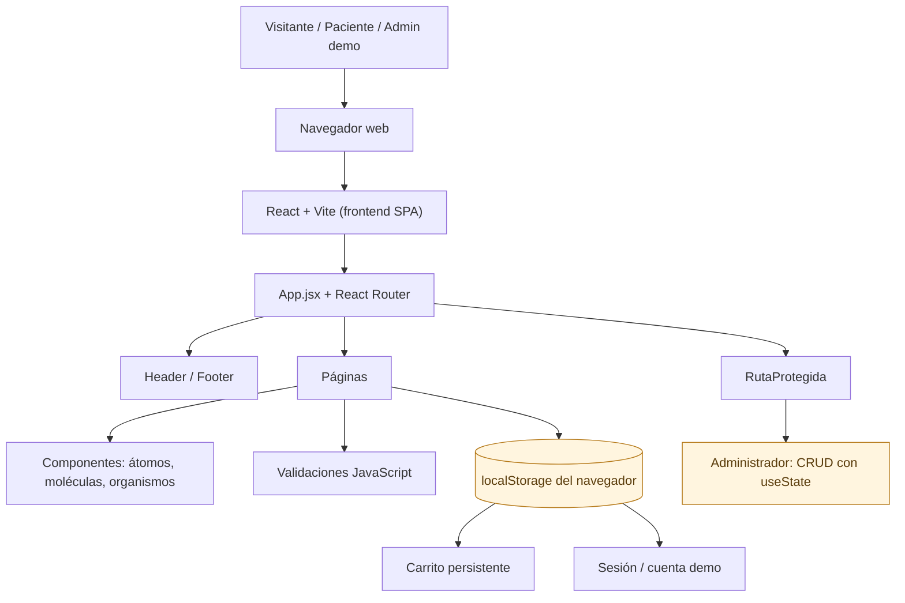
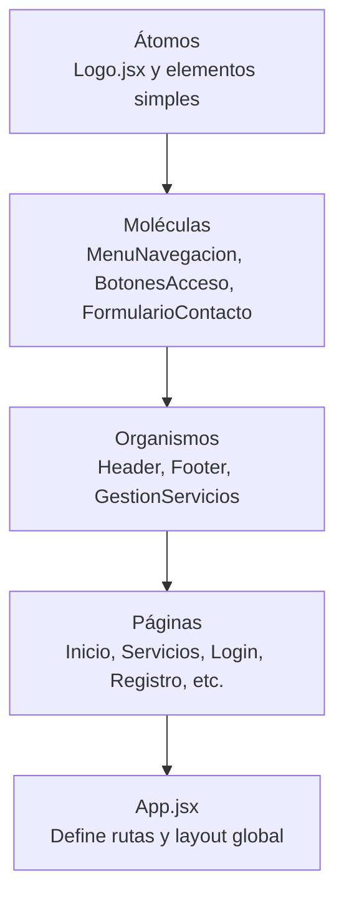
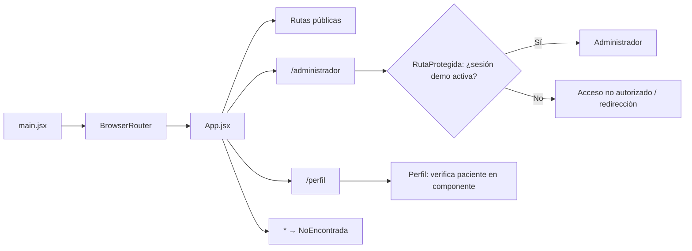
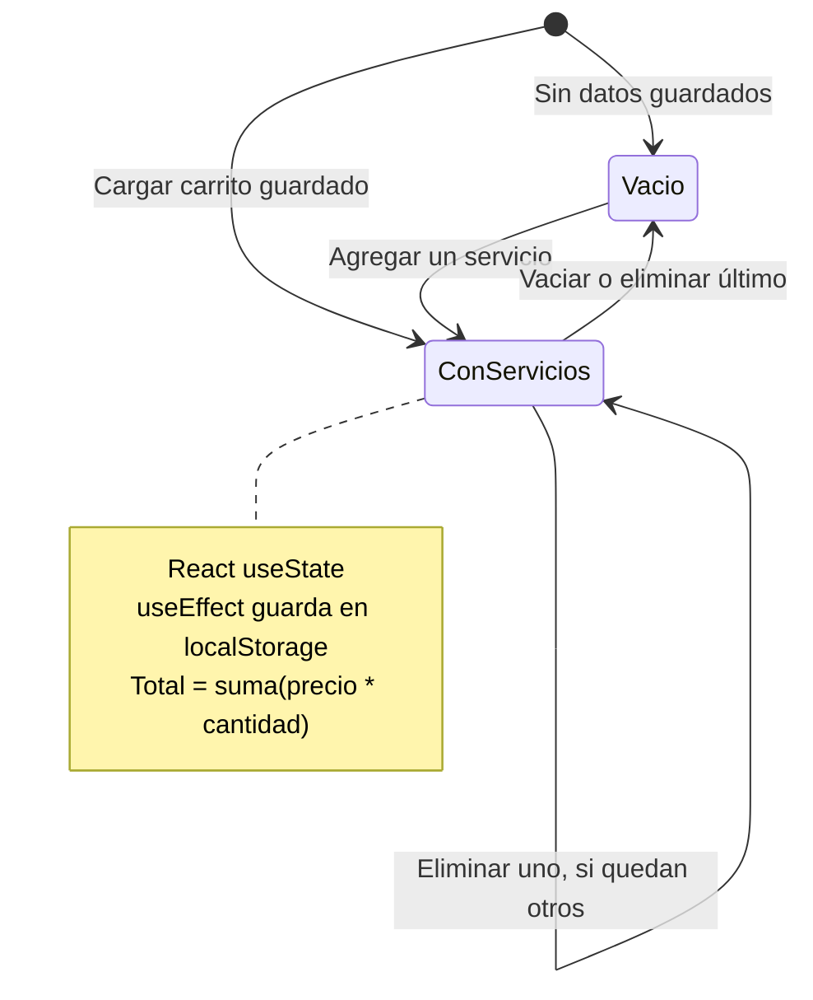
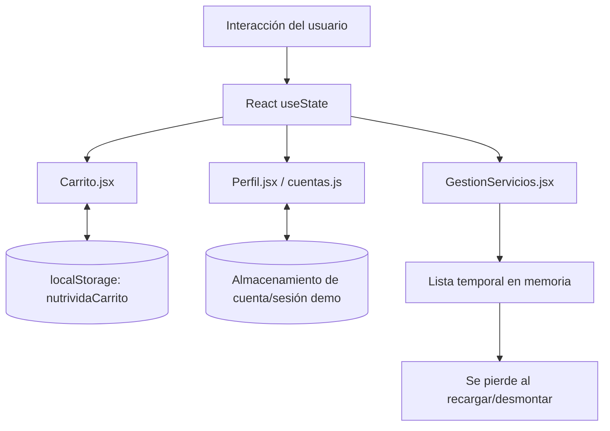
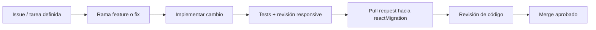

# NutriVida | Clínica Nutricional

**Aplicación web de demostración para presentar servicios nutricionales, registrar usuarios, consultar un perfil, gestionar un carrito y administrar servicios.**

NutriVida nació como un sitio en **HTML, CSS y JavaScript** y fue migrado a **React + Vite**, manteniendo la identidad visual de la primera versión. El proyecto es académico y está organizado con principios de **Atomic Design**, rutas mediante React Router y pruebas automatizadas con Vitest.

> **Estado del proyecto (22 de octubre de 2026):** prototipo funcional de frontend. **67 de 67 pruebas automatizadas aprobadas** en la última ejecución comunicada (8 archivos, 0 fallos). Se han realizado verificaciones manuales de diseño responsive y flujos de uso, pero la auditoría manual integral todavía no está cerrada. **No es un producto clínico ni un sistema de comercio electrónico listo para producción.**

[Repositorio](https://github.com/Liz-Elizabeth/Proyecto-NutriVida) · [Rama de desarrollo `reactMigration`](https://github.com/Liz-Elizabeth/Proyecto-NutriVida/tree/reactMigration) · [Rama de respaldo `respaldo-nutrivida-lizz`](https://github.com/Liz-Elizabeth/Proyecto-NutriVida/tree/respaldo-nutrivida-lizz) · [Plan de pruebas](./plan_de_pruebas.md)

---

## Índice

1. [Resumen y alcance](#1-resumen-y-alcance)
2. [Estado funcional y calidad](#2-estado-funcional-y-calidad)
3. [Tecnologías](#3-tecnologías)
4. [Arquitectura y diagramas](#4-arquitectura-y-diagramas)
5. [Estructura del repositorio](#5-estructura-del-repositorio)
6. [Inicio rápido e instalación](#6-inicio-rápido-e-instalación)
7. [Rutas y roles](#7-rutas-y-roles)
8. [Funciones y reglas de negocio](#8-funciones-y-reglas-de-negocio)
9. [Datos, estado y persistencia](#9-datos-estado-y-persistencia)
10. [Pruebas y estrategia de calidad](#10-pruebas-y-estrategia-de-calidad)
11. [Diseño responsive y fidelidad visual](#11-diseño-responsive-y-fidelidad-visual)
12. [Seguridad y limitaciones conocidas](#12-seguridad-y-limitaciones-conocidas)
13. [Cómo contribuir](#13-cómo-contribuir)
14. [Hoja de ruta](#14-hoja-de-ruta)
15. [Despliegue y configuración](#15-despliegue-y-configuración)
16. [Solución de problemas](#16-solución-de-problemas)
17. [Documentación y mantenimiento](#17-documentación-y-mantenimiento)

---

## 1. Resumen y alcance

El sitio permite a visitantes conocer la clínica y sus planes nutricionales; a usuarios registrados acceder a un perfil demostrativo; y a un administrador de demostración operar un CRUD de servicios. El carrito permite seleccionar planes, cambiar cantidades y calcular precios en pesos chilenos (CLP).

**Objetivos de esta etapa**

- Migrar el sitio original a componentes React **sin rediseñar drásticamente la interfaz**.
- Separar responsabilidades de presentación según **átomos, moléculas, organismos y páginas**.
- Incorporar navegación SPA, estado interactivo con React y validaciones reutilizables.
- Demostrar registro/inicio de sesión, perfil, carrito, CRUD administrativo y una página 404.
- Contar con evidencia automatizada y manual de calidad.

**Fuera del alcance actual:** agenda real de pacientes, fichas clínicas, pagos, órdenes efectivas, envío de correos, API de backend, base de datos de servidor, control robusto de identidades y tratamiento seguro de datos clínicos.

### Estado ejecutivo

| Dimensión | Estado | Evidencia / observación |
|---|---|---|
| Migración visual HTML → React | Implementada | Estilos principales en `src/App.css`; revisiones visuales parciales contra el original |
| Arquitectura por componentes | Implementada | `src/components/atomos`, `moleculas`, `organismos` |
| Navegación SPA | Implementada y probada | 9 patrones de ruta, incluidos `/administrador` y `*` |
| Validaciones de registro e ingreso | Probadas a nivel de función | 25 pruebas entre registro y login |
| Contacto | Demostración probada | 4 pruebas; **no envía email** |
| Perfil | Implementado y probado por componente | 6 pruebas con funciones de cuentas simuladas |
| Carrito | Implementado y probado | 9 pruebas, incluida persistencia en `localStorage` |
| CRUD administrativo | Implementado y probado | 8 pruebas; almacenamiento **solo en `useState`** |
| Página 404 | Implementada y probada | 4 pruebas |
| Rutas y guardia administrativa | Probadas | 11 pruebas de selección de rutas y acceso |
| Pruebas automatizadas | **67/67 aprobadas** | Vitest 5.0.5; ejecución local, sin pipeline CI verificado |
| Pruebas manuales/responsive | En curso | Revisión visual en 320, 360, 375 y 768 px; pendientes validación formal completa y otros tamaños |
| Seguridad y producción | **No apto para producción** | Autenticación y almacenamiento del lado del cliente, sin backend |

> **Cómo interpretar “probada”:** significa que pasó una prueba específica, no que se haya demostrado cobertura completa, seguridad de producción ni funcionamiento E2E en todos los navegadores.

---

## 2. Estado funcional y calidad

### Distribución de las 67 pruebas aprobadas



| Métrica | Resultado registrado |
|---|---:|
| Suites / archivos de prueba | 8 |
| Casos automatizados | 67 |
| Aprobados | 67 |
| Fallidos | 0 |
| Duración última ejecución compartida | 3,99 s |
| Fecha de la última ejecución compartida | 22-10-2026 |
| Cobertura de líneas/ramas | **No medida** (no confundir 67/67 con porcentaje de cobertura) |

**Versión de referencia en Git:** commit `b283a5e`, subido exitosamente a `reactMigration` y `respaldo-nutrivida-lizz` según la ejecución de Git compartida el 22-10-2026. Comprobar en GitHub si hubo cambios posteriores.

---

## 3. Tecnologías

| Categoría | Herramienta | Función |
|---|---|---|
| Interfaz | React + JSX | Componentes y estado de UI |
| Entorno de desarrollo y compilación | Vite | Servidor local, HMR y compilación |
| Lenguaje | JavaScript (ES Modules) | Lógica y validaciones |
| Navegación | React Router | Rutas de la SPA y navegación interna |
| Diseño | CSS3 + Flexbox + Grid | Identidad visual, diseño adaptable |
| Maquetación complementaria | React Bootstrap / Bootstrap Grid | Distribución responsive donde se utiliza |
| Persistencia de demostración | `localStorage` | Carrito y datos/sesión de usuario del navegador |
| Pruebas | Vitest **5.0.5** | Ejecución automatizada |
| Pruebas de interfaz | React Testing Library | Simulación de interacción con componentes |
| Entorno de prueba | jsdom | DOM simulado en Node.js |
| Control de versiones | Git + GitHub | Commits, ramas y colaboración |

**Versiones:** las versiones exactas de React, Vite, Router y otras dependencias deben consultarse en [`package.json`](./package.json) y el lockfile; no se fijan aquí para evitar desincronización. El proyecto ha sido ejecutado en entorno Windows con Node.js LTS y npm. **No utiliza `src/index.css`; los estilos del proyecto están centralizados en `src/App.css`.**

---

## 4. Arquitectura y diagramas

### 4.1 Vista de alto nivel



> **Límite de confianza:** todo lo representado está del lado del cliente. `RutaProtegida` mejora la navegación del prototipo, pero **no es una barrera de seguridad de servidor**. No hay backend o base de datos clínica detrás de estas rutas.

### 4.2 Composición de interfaz (Atomic Design)



*El diagrama es conceptual: los niveles no significan que absolutamente todos los componentes importen directamente al nivel siguiente.*

### 4.3 Inicio y navegación



### 4.4 Flujo del carrito



---

## 5. Estructura del repositorio

Vista de referencia de los módulos conocidos del proyecto; puede haber archivos auxiliares adicionales:

```text
Proyecto-NutriVida/
├── index.html                     # Entrada HTML, idioma y viewport
├── package.json                   # Dependencias y scripts npm
├── package-lock.json              # Resolución reproducible de dependencias
├── vite.config.js                 # Configuración de Vite
├── eslint.config.js               # Configuración de lint (si se ejecuta)
├── README.md                      # Este documento
├── plan_de_pruebas.md             # Casos CP01-CP67; pruebas manuales
├── public/                         # Recursos estáticos, si corresponde
└── src/
    ├── main.jsx                  # Monta React y BrowserRouter
    ├── App.jsx                   # Header, rutas, Footer
    ├── App.css                   # CSS principal y media queries
    ├── RutaProtegida.jsx         # Guardia demostrativa del admin
    ├── assets/
    │   └── img/                  # Logos, profesionales e imágenes de servicios
    ├── components/
    │   ├── atomos/
    │   │   └── Logo.jsx
    │   ├── moleculas/
    │   │   ├── MenuNavegacion.jsx
    │   │   ├── BotonesAcceso.jsx
    │   │   └── FormularioContacto.jsx
    │   └── organismos/
    │       ├── Header.jsx
    │       ├── Footer.jsx
    │       └── GestionServicios.jsx
    ├── pages/
    │   ├── Inicio.jsx
    │   ├── Servicios.jsx
    │   ├── Servicio.jsx
    │   ├── Login.jsx
    │   ├── Registro.jsx
    │   ├── Administrador.jsx
    │   ├── Carrito.jsx
    │   ├── Perfil.jsx
    │   └── NoEncontrada.jsx
    ├── validaciones/
    │   ├── validarLogin.js
    │   └── validarRegistro.js
    ├── datos/
    │   └── cuentas.js            # Funciones de cuenta/persistencia demo
    └── tests/
        ├── validarRegistro.test.js
        ├── validarLogin.test.js
        ├── FormularioContacto.test.jsx
        ├── Perfil.test.jsx
        ├── Carrito.test.jsx
        ├── GestionServicios.test.jsx
        ├── NoEncontrada.test.jsx
        └── Navegacion.test.jsx
```

**Decisión vigente:** conservar por ahora la arquitectura sencilla y la hoja de estilos centralizada. No dividir el CSS ni rediseñar los componentes como parte de una contribución no solicitada; la fidelidad con el HTML original es un requisito académico.

---

## 6. Inicio rápido e instalación

### Requisitos previos

- Git.
- Node.js **LTS** y npm instalados; revisar `node -v` y `npm -v`.
- Un editor (se ha utilizado Visual Studio Code).
- Navegador moderno como Chrome o Edge.

### Clonar el proyecto

```bash
git clone --branch reactMigration https://github.com/Liz-Elizabeth/Proyecto-NutriVida.git
cd Proyecto-NutriVida
```

### Instalar dependencias

En Windows / PowerShell:

```powershell
npm.cmd ci
```

En macOS / Linux:

```bash
npm ci
```

`npm ci` utiliza el `package-lock.json` y es preferible para reproducir el entorno. No se debe versionar `node_modules`.

### Iniciar desarrollo

**PowerShell (Windows):**

```powershell
npm.cmd run dev
```

**macOS / Linux:**

```bash
npm run dev
```

Abrir la URL indicada por Vite, normalmente **http://localhost:5173/**. Si Vite informa otro puerto, usar el mostrado en la terminal. Mantener esa terminal activa mientras se navega.

### Compilación y vista previa

Antes de usarlos, confirmar que existen los scripts correspondientes en `package.json` (son los nombres habituales de un proyecto Vite):

```powershell
npm.cmd run build
npm.cmd run preview
```

La salida de compilación suele guardarse en `dist/`. **No se ha verificado en esta documentación una compilación de producción ni un despliegue real.**

### Comandos útiles

| Tarea | Windows / PowerShell |
|---|---|
| Instalar desde lockfile | `npm.cmd ci` |
| Desarrollo | `npm.cmd run dev` |
| Pruebas automatizadas | `npm.cmd exec -- vitest run` |
| Pruebas de un archivo | `npm.cmd exec -- vitest run src/tests/Carrito.test.jsx` |
| Compilar (si existe script) | `npm.cmd run build` |
| Revisar cambios de Git | `git status` |

---

## 7. Rutas y roles

Definidas en [`src/App.jsx`](./src/App.jsx):

| Ruta | Página | Acceso / comportamiento |
|---|---|---|
| `/` | `Inicio.jsx` | Público: presentación, profesionales, secciones y contacto |
| `/servicios` | `Servicios.jsx` | Público: catálogo de planes |
| `/servicio` | `Servicio.jsx` | Público: detalle de servicios |
| `/login` | `Login.jsx` | Público: formulario de inicio de sesión |
| `/registro` | `Registro.jsx` | Público: formulario de registro |
| `/carrito` | `Carrito.jsx` | Página accesible; datos del carrito en navegador |
| `/perfil` | `Perfil.jsx` | Ruta declarada sin guardia global; el componente verifica si existe paciente activo |
| `/administrador` | `Administrador.jsx` | Envuelta por `RutaProtegida` y sesión demo |
| `*` | `NoEncontrada.jsx` | Página 404 y enlace de retorno al inicio |

**Layout compartido:** `Header` y `Footer` están fuera del componente `Routes`, por lo que aparecen en todas las páginas.

**Fragmentos de la página principal:** pueden utilizarse anclas `#nosotros`, `#especialidades`, `#profesionales` y `#contacto` según los enlaces del menú. Verificar navegación y desplazamiento real en el navegador al contribuir a ellas.

---

## 8. Funciones y reglas de negocio

### Registro

- Captura RUN, nombre, apellidos, correo, fecha de nacimiento, región, comuna, objetivo nutricional, dirección y contraseñas.
- Valida obligatoriedad, caracteres permitidos, formato de RUN, dominios autorizados, coincidencia de contraseñas y fechas existentes.
- La validación de año contempla rechazar, por ejemplo, años de seis cifras.
- Validaciones reutilizables en `src/validaciones/validarRegistro.js`.
- La persistencia de usuarios es **local y demostrativa**, no una identidad clínica real.

### Login y sesión

- Verifica estructura de correo y longitud de contraseña mediante `validarLogin.js`.
- Existe una sesión demostrativa de administrador que usa la clave de almacenamiento `nutrividaSesion`.
- Hay flujo demostrativo de cuenta/paciente mediante `src/datos/cuentas.js` y un perfil asociado.
- **No hay autenticación de servidor, emisión de JWT ni controles de autorización backend.** No introducir información sensible.

### Perfil

- Presenta información de la cuenta activa.
- Campos inicialmente bloqueados; `Editar datos` los habilita.
- `Guardar cambios` actualiza los datos mediante funciones de cuenta; `Cancelar` revierte cambios sin guardar.
- Permite cerrar sesión.
- La prueba de componente usa funciones de cuenta simuladas: requiere comprobación integral manual del almacenamiento real.

### Carrito

- Ofrece **seis** servicios con precios base en CLP.
- Permite agregar un servicio, incrementar/decrementar cantidad, eliminar uno y vaciar el conjunto.
- La cantidad mínima de una línea es 1; cuando está en 1, el botón de disminución se deshabilita.
- Cálculo: `total = Σ (precioUnitario × cantidad)`.
- Persiste el arreglo en la clave `nutrividaCarrito` del `localStorage` del navegador.
- No implementa pasarela de pago ni pedido real.

### Administrador (CRUD)

- En `GestionServicios.jsx` permite **Crear, Leer, Actualizar y Eliminar** servicios.
- Alta y edición requieren nombre no vacío y precio numérico mayor que cero.
- Los registros de este panel viven en **`useState`** y usan una imagen por defecto (`/imagen-servicio.png`).
- Los nuevos IDs del CRUD se crean mediante `Date.now()`. Si dos altas ocurrieran dentro del mismo milisegundo podría producirse una colisión: es un riesgo técnico a corregir antes de ampliar el módulo.
- **Importante:** el CRUD temporal no está conectado a la lista fija de seis servicios que usa `Carrito.jsx`; crear servicios en el administrador **no significa** publicarlos en el catálogo ni agregarlos al carrito.

### Contacto

- Requiere nombre, correo válido y mensaje.
- Muestra errores, elimina mensajes antiguos al editar y limpia campos tras una validación correcta.
- **No envía correos ni consultas reales.** El mensaje de éxito solo confirma la validación del formulario de demostración.

### Página 404

- Muestra el código 404 y un enlace a `/`.

---

## 9. Datos, estado y persistencia

### Mapa de responsabilidad



| Dato | Dónde vive | Qué persiste | Precaución |
|---|---|---|---|
| Carrito | `Carrito.jsx` + `localStorage` | Arreglo `{ id, cantidad }` | No usar como pedido confirmado |
| Estado de acceso admin | `RutaProtegida.jsx` / login demo | Indicador `nutrividaSesion` | Modificable desde DevTools; **no es seguridad** |
| Cuenta del paciente | `src/datos/cuentas.js` | Información local demo | No usar datos ni contraseñas reales |
| Servicios del CRUD | `GestionServicios.jsx` (`useState`) | Solo mientras exista la instancia | No hay base de datos ni sincronización con catálogo |
| Formulario de Contacto | Estado React | No tiene envío real | Validación ≠ mensaje entregado |

Ejemplo **ilustrativo de la estructura realmente usada por el carrito**:

```json
[
  { "id": 1, "cantidad": 2 },
  { "id": 4, "cantidad": 1 }
]
```

**No modificar manualmente el `localStorage` de un usuario real para probar la aplicación.** Usar cuentas ficticias y el contexto local de desarrollo.

---

## 10. Pruebas y estrategia de calidad

Las pruebas siguen el patrón **AAA: Arrange / Act / Assert** (Preparar / Actuar / Comprobar).

### Ejecución

```powershell
npm.cmd exec -- vitest run
```

### Inventario

| Suite | Archivo | Casos | Estado en última ejecución |
|---|---|---:|---|
| Validaciones de registro | `src/tests/validarRegistro.test.js` | 15 | Aprobada |
| Validaciones de login | `src/tests/validarLogin.test.js` | 10 | Aprobada |
| Formulario de Contacto | `src/tests/FormularioContacto.test.jsx` | 4 | Aprobada |
| Mi Perfil | `src/tests/Perfil.test.jsx` | 6 | Aprobada |
| Carrito | `src/tests/Carrito.test.jsx` | 9 | Aprobada |
| CRUD de servicios | `src/tests/GestionServicios.test.jsx` | 8 | Aprobada |
| Página 404 | `src/tests/NoEncontrada.test.jsx` | 4 | Aprobada |
| Navegación | `src/tests/Navegacion.test.jsx` | 11 | Aprobada |
| **Total** | **8 archivos** | **67** | **67 aprobadas, 0 fallidas** |

**Limitaciones de estas pruebas**

- Registro y Login prueban principalmente **funciones de validación**, no todos los flujos de autenticación.
- En Perfil se emplean *mocks* para las operaciones de cuentas.
- En Navegación se simulan páginas, `Header` y `Footer`; se comprueba la selección de rutas, no cada enlace real ni su apariencia.
- El CRUD se prueba en estado temporal del componente.
- No se han publicado métricas verificadas de *code coverage*, auditorías de accesibilidad, pruebas de carga ni E2E de navegador automatizadas.
- Los cambios CSS no quedan validados visualmente por Vitest: requieren pruebas en Chrome u otros navegadores.

### Pruebas manuales recomendadas

Ver los procedimientos CP01–CP67 y PM01–PM12 en [`plan_de_pruebas.md`](./plan_de_pruebas.md). En las revisiones compartidas se comprobó visualmente el comportamiento de Contacto, el menú, el Footer, el carrito y el administrador en tamaños de celular/tablet; **la matriz formal de pruebas manuales debe actualizarse** con fecha, resultado y evidencia de cada caso.

**Antes de un pull request:** ejecutar pruebas, comprobar la interfaz en el navegador, revisar la consola y documentar capturas cuando el cambio afecte al CSS.

---

## 11. Diseño responsive y fidelidad visual

El requisito académico principal es conservar la identidad visual del proyecto original: **paleta verde, logo, estructura y contenido**, adaptándolos a React. El CSS se concentra en `src/App.css` y utiliza `@media`, Flexbox y Grid.

### Puntos de ruptura utilizados

| Anchura | Comportamiento destacado |
|---|---|
| Hasta **600 px** | Disposición móvil, controles en columna, Footer adaptado |
| Hasta **700 px** | Formulario administrativo en una columna |
| Hasta **900 px** | Reorganización de secciones, incluido Contacto en una columna |
| Más de **900 px** | Distribuciones más amplias, por ejemplo Contacto en dos columnas |

### Matriz visual mínima antes de entregar

| Ancho de prueba | Tipo | Qué revisar |
|---|---|---|
| 320 px | Celular estrecho | Header, Registro, Contacto, CRUD, carrito, Footer |
| 360 / 375 px | Celular | Menú, tarjetas, textos, navegación sin recortes |
| 768 px | Tablet | Contacto y formularios, imágenes, navegación |
| 1024 px | Tablet horizontal | Columnas, espacios y tarjetas |
| 1366 px | Escritorio | Fidelidad con HTML/CSS original |

**No considerar un cambio visual completo hasta revisar al menos las rutas afectadas en móvil y escritorio.** Evitar `overflow-x: hidden` como solución genérica a contenidos cortados: primero identificar la regla que produce el desbordamiento.

---

## 12. Seguridad y limitaciones conocidas

> ⚠️ **NutriVida es una demostración académica. No ingresar RUN reales, datos médicos, credenciales personales ni información de pacientes.**

| Área | Situación actual | Requisito antes de producción |
|---|---|---|
| Autenticación | Flujo local / demostrativo | Backend, autenticación segura, sesiones protegidas |
| Autorización | Guardia de rutas en React | Autorización en servidor por rol y recurso |
| Contraseñas | Manejo de demostración en navegador | Hash seguro en servidor (p. ej., Argon2id), nunca confiar en almacenamiento del cliente |
| Datos personales | Almacenamiento local | Consentimiento, protección y retención adecuados; backend y controles de acceso |
| CRUD | Memoria del componente | API, almacenamiento persistente y validación del lado del servidor |
| Catálogo y carrito | Fuentes de datos separadas | Una fuente de verdad compartida y validación de precios del lado del servidor |
| Contacto | Validación sin envío | Servicio/API de mensajería con protección contra abuso |
| Pago | No implementado | Integración con un proveedor regulado y gestión de órdenes |
| Pruebas | Unitarias/de componentes y navegación simulada | E2E, integración, accesibilidad, seguridad y CI |
| Dependencias | Bloqueadas por lockfile | Monitoreo de vulnerabilidades y actualizaciones controladas |

### Deuda técnica priorizada

1. **Seguridad:** no presentar rutas protegidas por frontend como control de acceso real.
2. **Fuente de datos:** sincronizar catálogo público, CRUD administrativo y carrito.
3. **Persistencia:** sustituir `useState` temporal y almacenamiento de cuentas por arquitectura con backend.
4. **IDs:** evitar depender de `Date.now()` para identificadores únicos del CRUD.
5. **Pruebas:** sumar integración real de cuentas y E2E del flujo principal.
6. **Accesibilidad:** auditar navegación por teclado, foco, contraste, etiquetas y avisos.
7. **Documentación:** revisar comentarios heredados que todavía mencionan HTML antiguo o `css/styles.css`; el CSS actual está en `src/App.css`.

Estas observaciones son **limitaciones conocidas o mejoras sugeridas**, no incidencias formalmente abiertas en GitHub.

---

## 13. Cómo contribuir

Se aceptan propuestas para corregir errores, añadir tests, mejorar accesibilidad o desarrollar funcionalidades acordadas, **sin rediseñar el proyecto original ni alterar su arquitectura sin discusión previa**.

### Flujo de colaboración propuesto



**1. Obtener el estado actual**

```bash
git checkout reactMigration
git pull --ff-only origin reactMigration
```

**2. Crear una rama corta y descriptiva**

```bash
git checkout -b fix/footer-responsive
```

**3. Trabajar y verificar**

```powershell
npm.cmd ci
npm.cmd exec -- vitest run
npm.cmd run build
```

*Si el script `build` no aparece en `package.json`, comprobar su configuración antes de ejecutarlo.*

**4. Registrar cambios y subir la rama**

```bash
git status
git add <archivos-modificados>
git commit -m "fix: ajustar footer en pantallas pequeñas"
git push -u origin fix/footer-responsive
```

**5. Abrir un Pull Request hacia `reactMigration`.** No enviar cambios directamente a `main` ni usar `git push --force` sobre las ramas compartidas.

### Convenciones sugeridas

- **Componentes:** nombres PascalCase en archivos `.jsx` (por ejemplo, `FormularioContacto.jsx`).
- **Funciones y variables:** camelCase descriptivo; mantener el español cuando sea coherente con los módulos existentes.
- **Tests:** sufijo `.test.js` para lógica y `.test.jsx` para componentes; ubicarlos en `src/tests/`.
- **Rutas:** mantener consistencia con `src/App.jsx`.
- **CSS:** modificar `src/App.css`, preferir reglas acotadas, evitar sobrescribir globalmente estilos de otras páginas.
- **Commits:** mensajes orientados a cambio, p. ej. `fix:`, `feat:`, `test:`, `docs:` (convención propuesta, no requisito ya automatizado).
- **Documentación:** actualizar `README.md` y `plan_de_pruebas.md` si cambian funciones, rutas o tests.

### Checklist para un Pull Request

- [ ] Explico el problema o requisito y las rutas afectadas.
- [ ] Mantengo el diseño original donde la evaluación exige fidelidad visual.
- [ ] Añado o actualizo tests del comportamiento modificado.
- [ ] Ejecuto `npm.cmd exec -- vitest run` y reporto el resultado real.
- [ ] Verifico móvil (mínimo 320/375 px) y escritorio si cambié estilos.
- [ ] Reviso errores y advertencias relevantes de consola.
- [ ] No incorporo secretos, contraseñas reales ni datos clínicos.
- [ ] Actualizo la documentación y adjunto evidencia visual si corresponde.
- [ ] Solicito revisión antes de fusionar a `reactMigration`.

---

## 14. Hoja de ruta

Esta lista es una **propuesta técnica**, no un calendario aprobado ni una promesa de implementación.

| Prioridad | Trabajo | Criterio de finalización sugerido |
|---|---|---|
| P0 | Cerrar matriz de pruebas manuales | PM01–PM12 con fecha, resultado y evidencia |
| P0 | Actualizar ERS y planilla de requisitos de segunda etapa | Requisitos y trazabilidad consistentes con React actual |
| P0 | Revisar build y artefacto de entrega | `npm run build` correcto, paquete sin `node_modules` para distribución |
| P1 | Pruebas E2E básicas | Registro/login demo, perfil, carrito y navegación en navegador real |
| P1 | Fuente única de servicios | Catálogo, administración y carrito comparten modelo coherente |
| P1 | Accesibilidad y responsive | Auditoría de teclado y contraste; pruebas en pantallas clave |
| P2 | Backend y datos persistentes | API y base de datos con validaciones de servidor |
| P2 | Autenticación y roles reales | Sesiones y autorización verificadas en backend |
| P2 | Agenda nutricional / gestión clínica | Solo previo diseño de privacidad y requisitos legales |
| P2 | CI/CD | Pipeline de lint, test, build y despliegue controlado |

---

## 15. Despliegue y configuración

- La aplicación es una **SPA de React** servida por Vite en desarrollo.
- Una compilación de producción (habitualmente en `dist/`) requiere hosting estático compatible con **fallback a `index.html`** para rutas como `/servicios` o `/carrito`.
- No se ha verificado un despliegue público, dominio definitivo ni variables de entorno de producción.
- No asumir que hay una API, base de datos o proveedor de pagos configurados.
- Si se incorporan variables `.env`, **no versionar secretos**. Usar `.env.example` sin credenciales reales.
- Desplegar no vuelve seguro al modelo de sesión local: antes de operar con datos reales hay que implementar backend y controles adecuados.

---

## 16. Solución de problemas

| Síntoma | Posible causa | Acción sugerida |
|---|---|---|
| `localhost:5173` rechaza conexión | Vite detenido | Ejecutar `npm.cmd run dev` y dejar la terminal abierta |
| Vite usa otro puerto | El 5173 está ocupado | Abrir la URL exacta que muestra la terminal |
| PowerShell bloquea `npm.ps1` | Política local de ejecución | Usar `npm.cmd` en lugar de `npm` |
| Error al importar CSS viejo | Referencia heredada a `index.css` | Mantener `App.css` importado desde `App.jsx`; revisar imports |
| Una ruta funciona en desarrollo y falla al refrescar en producción | Falta fallback SPA | Configurar redirección a `index.html` en el hosting |
| Carrito no se conserva | `localStorage` deshabilitado o limpiado | Comprobar almacenamiento del navegador y código de `Carrito.jsx` |
| CRUD desaparece al recargar | Comportamiento esperado | Usa `useState` sin persistencia de servidor |
| Contacto no llega por correo | Comportamiento esperado | Formulario demostrativo sin API de envío |
| Tests fallan tras mover carpetas | Imports relativos desactualizados | Revisar rutas `../` en `src/tests/` |
| Menú o formulario se corta | CSS / breakpoint o zoom del simulador | Inspeccionar en DevTools el elemento y el ancho real; corregir regla concreta |

---

## 17. Documentación y mantenimiento

- **Plan de pruebas vigente:** [`plan_de_pruebas.md`](./plan_de_pruebas.md), con CP01–CP67 y matriz manual PM01–PM12. La ejecución posterior compartida confirmó **67/67** a las **22:48:12 del 22-10-2026**, aunque el documento puede conservar una hora anterior en su sección histórica.
- **ERS y planilla:** existe documentación de la **primera evaluación** (HTML/CSS/JS). Su actualización formal a la migración React está pendiente; no atribuir al ERS antiguo funcionalidades nuevas que todavía no aparecen en él.
- **Repositorio:** [Liz-Elizabeth/Proyecto-NutriVida](https://github.com/Liz-Elizabeth/Proyecto-NutriVida).
- **Rama de trabajo:** `reactMigration`.
- **Rama de respaldo:** `respaldo-nutrivida-lizz`. Usarla como respaldo, no como destino normal de pull requests.
- **Último commit compartido:** `b283a5e` (referencia histórica, comprobar `git log` para versiones posteriores).
- **Licencia:** no se ha verificado un archivo `LICENSE`; **no se presume** una licencia abierta. Solicitar autorización del propietario antes de reutilizar el proyecto fuera de su contexto académico.

### Sugerencias para quien tome el proyecto

1. Leer este README y el plan de pruebas.
2. Revisar `App.jsx`, `RutaProtegida.jsx` y `src/datos/cuentas.js` antes de tocar login/perfil.
3. Revisar `Carrito.jsx` y `GestionServicios.jsx` antes de proponer persistencia o catálogo único.
4. Comparar capturas con el HTML original antes de modificar diseño.
5. Crear una rama y presentar cambios pequeños, verificables y con tests.

---

**NutriVida · Proyecto académico de desarrollo frontend.** Documentación técnica de referencia para colaboración. **Última actualización de este README: 22 de octubre de 2026.**
